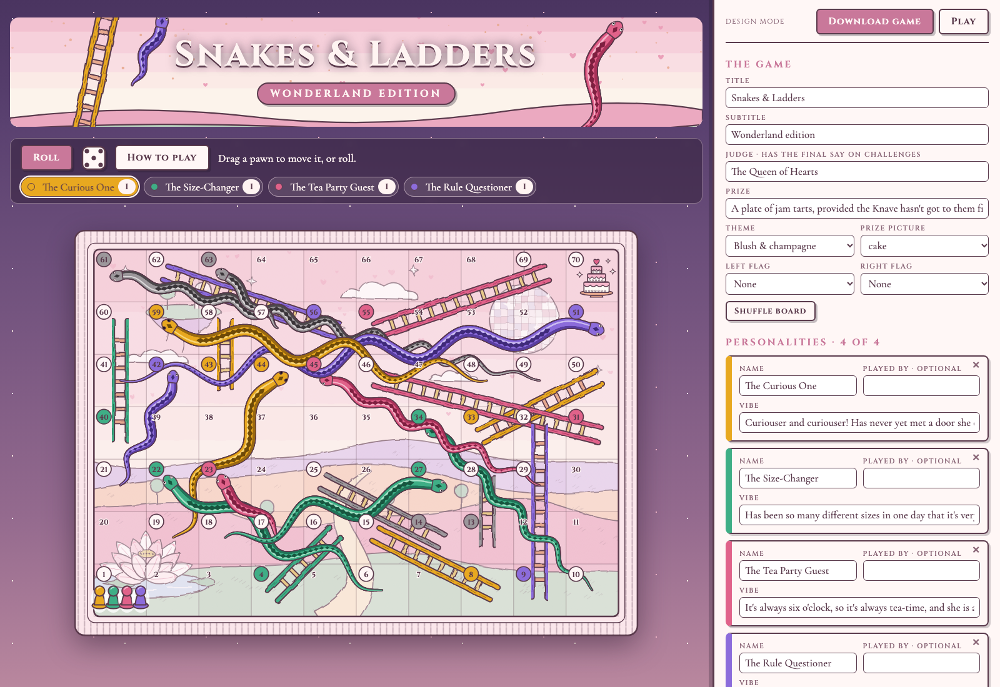

# Snakes & Ladders, about your friend

A customisable snakes and ladders board: every ladder is a win from their life, every snake a funny setback with an escape challenge. Made for birthdays, hen dos, farewells, anniversaries.

The board, snakes, ladders and scenery are drawn from your text, so every game looks different. The whole game is **one HTML file**: no install, no account, works offline, prints well.

It was made with Claude coding as a fun side project for a friend. Corrections and comments are welcome!

## Make a game

1. Open `index.html` in a browser and click **✎ Design your own game** under the board (or open `index.html#design`).
2. Fill in the form. The board redraws as you type.
3. Click **Download game**. You get one `.html` file. Send it to the group, or open it on a laptop or TV at the party.

The example is *Alice in Wonderland*. Click **Start from a blank game** at the bottom of the form to begin from scratch. Your work is kept in the browser as you go; if you close the tab, design mode offers to restore it next time.

The downloaded game opens straight into play mode, so players don't see the cards before they land on them. It still has the Design link, so you can keep editing your own copy.

## What goes in

| Field | What it's for |
|---|---|
| **Title, subtitle** | The banner. Subtitle is optional ("Birthday edition"). |
| **Judge** | Who settles escape challenges ("The birthday girl"). Leave empty to drop that rule. |
| **Prize** | Shown when someone wins. |
| **Theme** | Colours and sky: `dusk`, `twilight`, `storybook`, `poster`, `blush`. |
| **Prize picture** | Drawn on the last square: `cake`, `cow` or none. |
| **Flags** | Optional flag on either side of the board (Denmark, India). |
| **Shuffle board** | Same items, new arrangement. Use it if something didn't fit. |
| **Personalities** (1–4) | Sides of your friend ("The Overachiever", "The Night Owl"). Each gets a colour and a pawn. *Played by* is the guest playing it, optional. |
| **Ladders** | Wins. *Caption* is written on the board, *story* pops up on the card. |
| **Snakes** | Setbacks, plus an *escape challenge*: pass it and you don't slide. |

Each ladder and snake has a **personality** (or *Everyone*), which sets its colour, a **size** (small, medium, big: bigger wins are longer ladders), and an optional **picture** on its card.

### Tips for good cards

- Aim for 8–10 ladders and 8–10 snakes. The board grows from 60 to 100 squares to fit; about 30 items in total is the ceiling.
- Keep captions under about six words. The story can be as long and sappy as you like.
- Make challenges quick (under 30 seconds) and things the judge can rule on: "Guess her shoe size", "Do her laugh".

## Playing

Pick a personality each (alone or in teams). Press **Roll** or use a real die and drag your pawn. Land on a ladder's foot: read the card and climb. Land on a snake's head: read it, try the challenge, slide if you fail. Click any snake or ladder to read its card. Cards that have been read collect under the board.

To print, use the browser's print dialog: the title and board print, the controls don't.

## Privacy

Everything happens in your browser. Nothing is uploaded. The downloaded file contains everything you typed, so anyone you send it to can read it all (including the cards they haven't landed on yet, if they go looking).

## For developers

It's deliberately one file with no build step:

- The game's content is the JSON object between `/*DATA*/` and `/*END*/` in `index.html`. "Download game" saves a copy of the page with that object replaced. You can also edit it by hand.
- Same data and `seed` always give the same board.
- **Add a theme:** add an entry to `THEMES` (copy an existing one).
- **Add a picture:** write a `drawX(g)` function centred on 0,0 (about 80 units across) and register it in `PICTURES`.
- **Add a flag:** add a key to `FLAGS` and a branch in `drawSideFlag`.
- Tests: `node --test` (Node 18+) checks that the example lays out without dropping items, and that the layout is stable.
- `private/` is git-ignored. Keep real people's games there.

## License

MIT
